

# NovaNest — Retell AI Topic 9
## Post-Call Analysis, Scoring & QA Dashboards

**Retell AI · n8n · Google Sheets · Webhook Automation**

## Demo Videos

- **Loom Part 1:** <LOOM_LINK_1>
- **Loom Part 2:** <LOOM_LINK_2>

> Replace both placeholders with the final share links before submission.

## Table of Contents

- [Overview](#overview)
- [Architecture](#architecture)
- [PCA Fields](#pca-fields)
- [Google Sheets and n8n](#google-sheets-and-n8n)
- [Test Results](#test-results)
- [Evidence](#evidence)
- [Challenges and Assumptions](#challenges-and-assumptions)
- [Limitations](#limitations)
- [Potential Enhancements](#potential-enhancements)
- [Repository Structure](#repository-structure)

## Overview

This project configures 12 Post-Call Analysis (PCA) fields for the **NovaNest Consultation Booking Agent** in Retell AI and maps the analysis output into a Google Sheets call log through an existing n8n webhook workflow.

- **Agent:** Retell AI Single Prompt, Cimo voice.
- **Webhook event:** call_analyzed.
- **Google Sheet:** NovaNest Call Log.
- **n8n workflow:** NovaNest Webhook Call Log Pipeline (published).
- **Prompt and functions:** unchanged, as required by the implementation instruction: “No change is made to the prompt or function configuration.”

## Architecture

~~~mermaid
flowchart TD
    A[Retell call ends] --> B[call_analyzed webhook]
    B --> C[n8n Webhook]
    C --> D{Is call_analyzed?}
    D --> E{Has call_id?}
    E --> F[Lookup call_id in Sheet]
    F --> G{Duplicate?}
    G --> H[Map & Transform]
    H --> I[Append Row]
    I --> J[(Google Sheet: NovaNest Call Log)]
~~~

The workflow maps the 11 new PCA values from call_analysis and call_analysis.custom_analysis_data. The existing call_summary column is reused.

## PCA Fields

| Field | Type | Allowed values / rule |
|---|---|---|
| lead_score | Number | Integer from 0–10 |
| appointment_intent | Enum | Strong, Moderate, Low, None |
| objection_raised | Boolean | true / false |
| objection_type | Enum | Price, Timing, Competitor, Commitment, None |
| caller_sentiment | Enum | Positive, Neutral, Negative |
| required_fields_captured | Boolean | true / false |
| agent_asked_all_questions | Boolean | true / false |
| disqualification_applied | Boolean | true / false |
| next_action | Enum | Book Consultation, Send Follow-Up Email, Reassign to Senior Agent, No Action Required |
| qa_flag | Enum | Pass, Needs Review, Fail |
| qa_flag_reason | Text | One specific sentence for Needs Review/Fail; blank for Pass |
| call_summary | Built-in field | Two-sentence summary instruction |

The saved field configuration is available in [config/pca_fields.json](config/pca_fields.json).

## Google Sheets and n8n

The NovaNest Call Log sheet has **11 new columns (M–W)** after follow_up_status. The call_summary column already existed from Topic 8 and was reused.

Workflow code: [webhook/map-and-transform.js](webhook/map-and-transform.js). A Topic 8 backup is retained at [webhook/backup-map-transform-topic8.js](webhook/backup-map-transform-topic8.js).

A sample payload using test_call_topic9_001 successfully wrote a row to the sheet. This was a **sample-payload test, not a real voice call**.

## Test Results

Two real web calls and one sample-payload test were recorded. Retell credits were limited, so not all test cases were run. Full details are in [test-results/test-results.md](test-results/test-results.md).

| Test case | Status | Evidence-based note |
|---|---|---|
| TC-001 | Partial | Call B met score/intent/sentiment expectations; qa_flag was Fail due to the prompt mismatch |
| TC-002 | Not run | “Just exploring” scenario not tested |
| TC-003 | Pass (observed) | agent_asked_all_questions=false, QA Fail, and a specific reason observed |
| TC-004 | Not met | Clean Pass is not achievable with the unchanged prompt |
| TC-005 | Not run | Price-objection scenario not tested |
| TC-006 | Pass | No objection was correctly represented as false / None in observed calls |
| TC-007 | Not run (partial) | Send Follow-Up Email observed; other outcomes not tested |
| TC-008 | Partial | Two real calls checked; enum values were within allowed choices |
| TC-009 | Partial | Scores 0 and 8 observed; both were integers in the 0–10 range |
| TC-010 | Partial | PCA columns and call summary populated and matched Retell values; 60-second timing was not measured |

### Observed real-call outputs

| Field | Call A | Call B |
|---|---|---|
| lead_score | 0 | 8 |
| appointment_intent | Moderate | Strong |
| caller_sentiment | Neutral | Positive |
| required_fields_captured | false | false |
| agent_asked_all_questions | false | false |
| qa_flag | Fail | Fail |
| next_action | Send Follow-Up Email | Send Follow-Up Email |

These results are documented as observed; they do not mean all assessment tests passed.

## Evidence

Screenshots are stored in [screenshots/](screenshots/).

### Workflow and integration

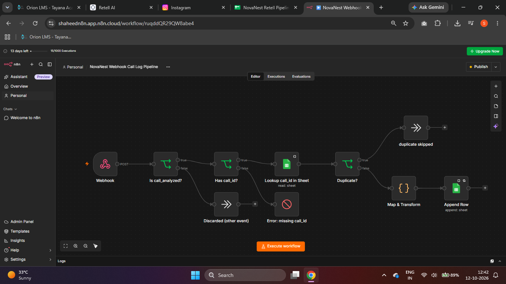
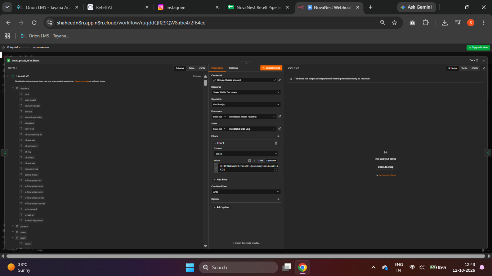
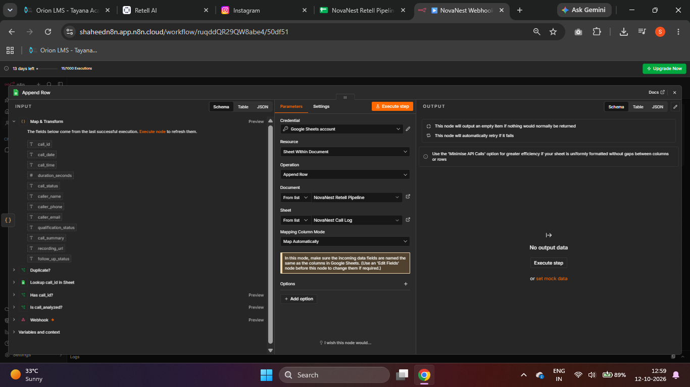
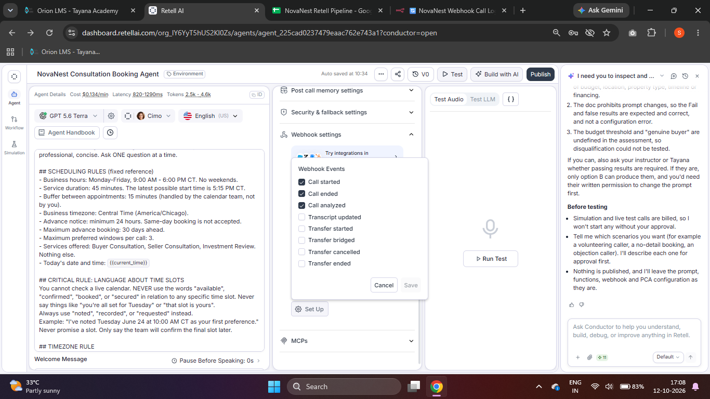

### PCA field examples

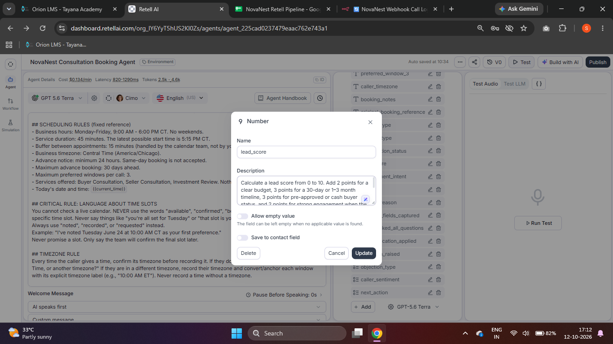
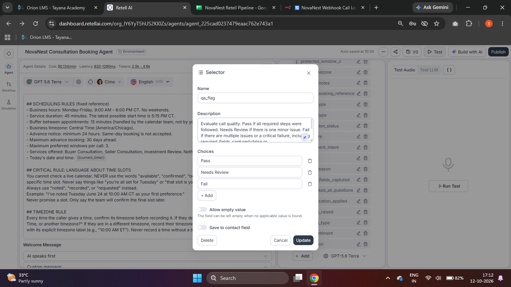
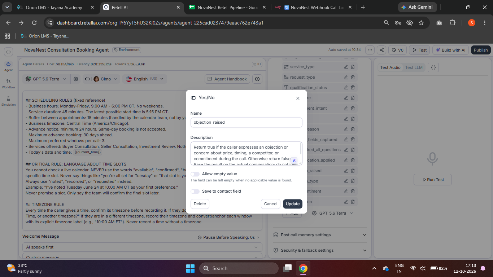

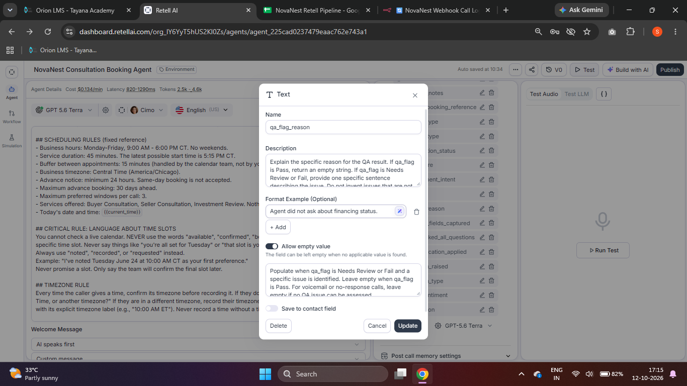

The Retell UI provides a Format Example box for Text fields; the Number, Yes/No, and Selector fields shown here do not have that box.

### Real-call and sheet outputs

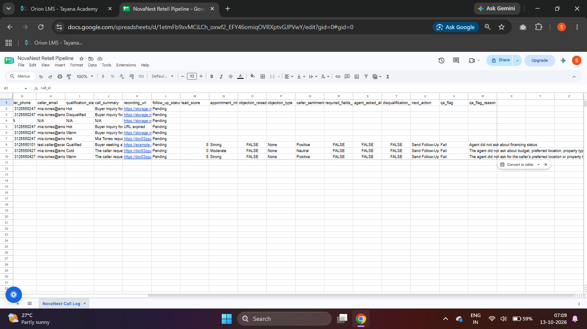
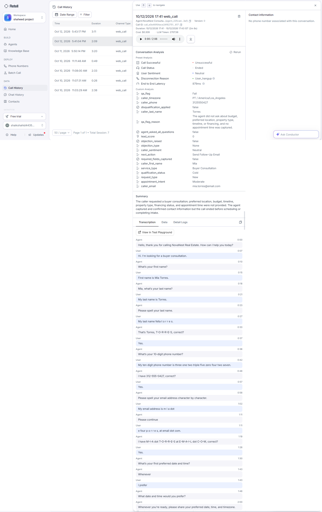
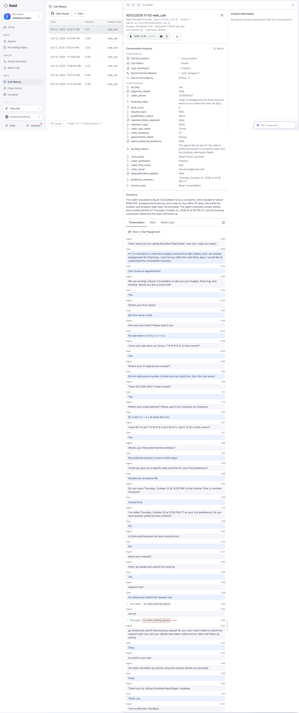
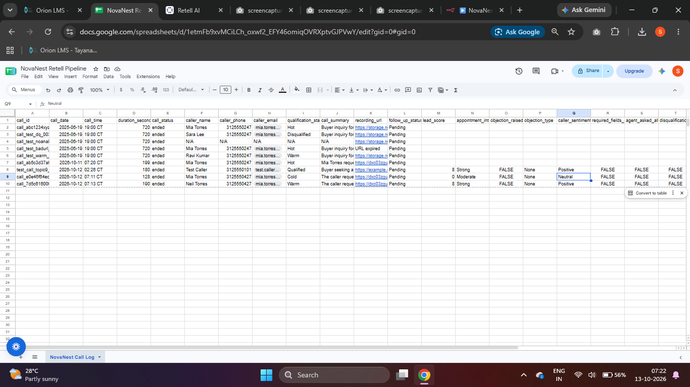
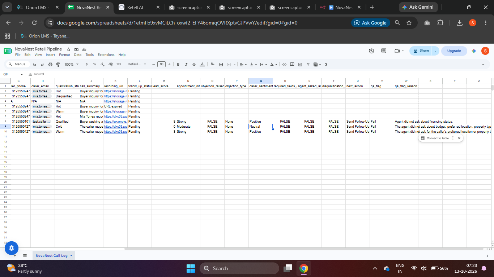

## Challenges and Assumptions

- The assessment rubrics require budget, preferred location, property type, timeline, and financing questions, but the existing consultation-booking prompt does not ask them.
- The saved PCA fields follow the supplied rubrics; the prompt and functions were not changed.
- A caller may volunteer information that the agent does not ask for, but this does not count as the agent asking the required questions.
- The sample-payload test validates the n8n-to-Sheets mapping path; it does not substitute for a real voice-call test.

## Limitations

- Because the prompt does not ask all five qualification questions, agent_asked_all_questions=false, required_fields_captured=false, and qa_flag=Fail are expected for the observed calls. TC-001, TC-004, and TC-007 cannot meet all expected outcomes under the unchanged prompt unless the relevant information and conditions are satisfied.
- The assessment does not define the budget disqualification threshold, “genuine buyer,” or “properly ended intake.”
- The existing qualification_status uses different disqualification criteria.
- create_booking_request returned an error during Call B; this was an existing Topic 8 function, not a PCA mapping error.
- No written instructor clarification has been received.
- Only two real voice calls were run due to limited credits; several cases remain untested.

## Potential Enhancements

- Request instructor clarification on the prompt restriction and undefined disqualification criteria.
- If explicitly permitted by the assessment, align qualification questions and test expectations in a future revision.
- Run remaining test cases when credits are available.
- Add Google Sheets filters or summary charts after the assessment rules are clarified.

## Repository Structure

~~~text
.
├── config/
│   └── pca_fields.json
├── sample-payloads/
│   └── call_analyzed_sample.json
├── screenshots/
├── test-results/
│   └── test-results.md
├── webhook/
│   ├── backup-map-transform-topic8.js
│   └── map-and-transform.js
└── README.md
~~~
